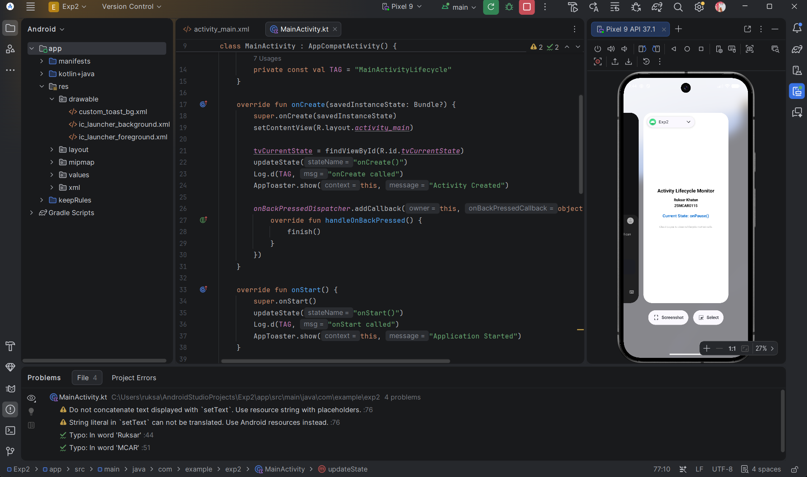
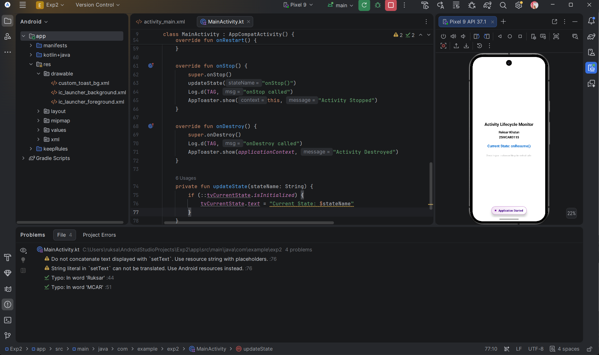

# Android Activity Lifecycle Experiment

## Overview
This experiment is designed to demonstrate and monitor the different states an Android Activity goes through during its lifecycle. By implementing and overriding the standard lifecycle callback methods, we can observe how the Android OS manages system resources and user interactions. This project provides both real-time on-screen feedback and technical logs for a comprehensive understanding of the Activity state machine.

## Core Experiment
The primary objective is to track and visualize the seven key lifecycle states:
1. **onCreate()**: Called when the activity is first created.
2. **onStart()**: Called when the activity becomes visible to the user.
3. **onResume()**: Called when the activity starts interacting with the user.
4. **onPause()**: Called when the system is about to start resuming another activity.
5. **onStop()**: Called when the activity is no longer visible to the user.
6. **onRestart()**: Called after the activity has been stopped, prior to it being started again.
7. **onDestroy()**: Called before the activity is destroyed.

The experiment uses a custom Toast utility (`AppToaster`) to display state transitions and personalized information (like student name and USN) directly on the UI, while also logging these events to **Logcat** for technical verification.

## Concept & Technology
### Activity Lifecycle
In Android, activities are managed as a "back stack". When a new activity is started, it is placed on the top of the stack and becomes the running activity. The lifecycle methods allow developers to handle transitions between being in the foreground, background, or destroyed.

### Technologies Used:
- **Language**: Kotlin
- **UI Framework**: XML Layouts with ConstraintLayout and LinearLayout.
- **Logging**: Android `Log` class for debugging.
- **Notifications**: Custom `Toast` implementation for a branded laboratory feel.

## Project Structure
The project follows a standard Android directory structure:

```text
Exp2/
├── app/
│   └── src/
│       └── main/
│           ├── java/com/example/exp2/
│           │   ├── MainActivity.kt       # Core logic and lifecycle overrides
│           │   ├── MyApplication.kt      # Global application state tracking
│           │   └── AppToaster.kt         # Custom notification utility
│           ├── res/
│           │   ├── layout/
│           │   │   ├── activity_main.xml # Main UI layout (Name, USN, State)
│           │   │   └── layout_custom_toast.xml # Custom Toast UI
│           │   └── drawable/
│           │       └── custom_toast_bg.xml # Styled background for notifications
│           └── AndroidManifest.xml       # App configuration and entry point
└── README.md                             # Project documentation
```

## Output & Screenshots
This is the screenshots of the experiment, demonstrating the various lifecycle transitions and the personalized UI.

### General Output
The main screen displays the student's name, USN, and the current active lifecycle state in a clean, laboratory-style format.


---

### Test Cases

#### Test Case 1: Application Launch & Foreground State
- **Action**: Open the application from the launcher.
- **Observation**: The UI displays "Ruksar Khatun" and "25MCAR0115". A custom toast appears saying **"Name : Ruksar Khatun"** as the activity enters the `onResume()` state.
- **Screenshot**:


#### Test Case 2: Moving to Background (Pause)
- **Action**: Press the Home button or open Recent Apps.
- **Observation**: The activity enters the `onPause()` state. A custom toast appears displaying the USN: **"ID : 25MCAR0115"**, signifying the app has successfully transitioned to the background.
- **Screenshot**:


#### Test Case 3: Activity Restart & Recovery
- **Action**: Return to the application from the Recent Apps menu.
- **Observation**: The sequence `onRestart()` -> `onStart()` -> `onResume()` is triggered. A toast confirms **"Activity Restarted"**, and the on-screen "Current State" text updates to reflect the active status.
- **Screenshot**:


---
**Prepared by:** Ruksar Khatun  
**USN:** 25MCAR0115
