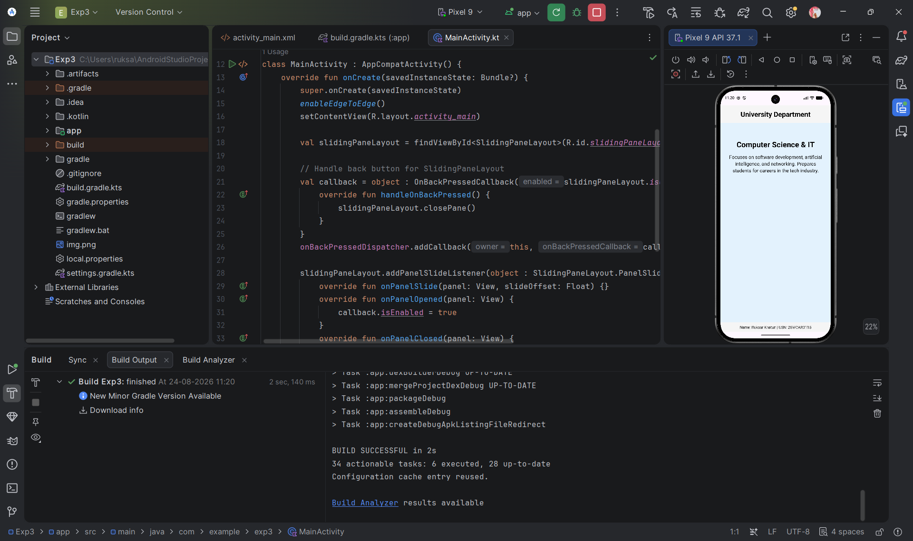

# University Department Explorer - Experiment 3

## Overview
This Android application demonstrates the implementation of a flexible and adaptive user interface using **Fragments**. The app provides a master-detail navigation pattern tailored for a university setting, allowing users to browse various departments and view detailed information about each.

## Technology and Concepts
The project leverages several core Android development technologies:
- **Fragments**: Used to create modular and reusable UI components. The app features a `ListFragment` for browsing and a `DetailFragment` for information display.
- **SlidingPaneLayout**: An adaptive UI component that automatically manages dual-pane layouts on large screens (tablets) and single-pane navigation on small screens (phones).
- **ViewModel**: A `DepartmentViewModel` is used to share state between fragments, ensuring data persistence across configuration changes.
- **RecyclerView**: Efficiently displays the list of university departments.
- **Material Design**: Uses Material Card components and a clean color palette for a professional look.

## Core Experiments & Debugging
The application is designed as a laboratory for Android Studio's debugging tools:
1.  **Lifecycle Observation**: By placing a breakpoint in `DetailFragment#onViewCreated`, developers can inspect the Fragment's lifecycle and local variable state during creation.
2.  **Conditional Breakpoints**: A conditional breakpoint on the department selection event allows pausing execution only when a specific item (e.g., "Computer Science & IT") is clicked, demonstrating advanced troubleshooting techniques.

## Project Scenario
The app showcases a **University Management** scenario with the following departments:
- Computer Science & Information Technology
- Business
- Finance
- Law
- Psychology

## Project Structure
```text
Exp3/
├── app/
│   ├── src/main/java/com/example/exp3/
│   │   ├── MainActivity.kt        # Main entry point, handles adaptive UI logic
│   │   ├── ListFragment.kt        # Handles the list of departments
│   │   ├── DetailFragment.kt      # Displays department descriptions
│   │   ├── DepartmentViewModel.kt # Shared data between fragments
│   │   ├── DepartmentAdapter.kt   # Adapter for RecyclerView
│   │   └── Department.kt          # Data model for Department entity
│   └── src/main/res/layout/
│       ├── activity_main.xml      # Root layout with Header and Footer
│       ├── fragment_list.xml      # Layout for the list view
│       ├── fragment_detail.xml    # Layout for the detail view
│       └── item_department.xml    # RecyclerView item design
└── README.md                      # This documentation
```

## Output & Test Cases

### Main Application UI & Identity Verification
The screenshot below shows the primary interface with the centered header "University Department". The footer correctly displays the developer's credentials.
- **Verification**: **Name: Ruksar Khatun | USN: 25MCAR0115**


---

### Test Case: Adaptive Layout & Department Selection
- **Scenario**: Running the app and selecting a department.
- **Expected Result**: The app adapts its layout based on screen size. Selecting a department (e.g., "Computer Science & IT") displays its specific details and background color.
- **Screenshot**: 

---
**Developer**: Ruksar Khatun  
**USN**: 25MCAR0115
