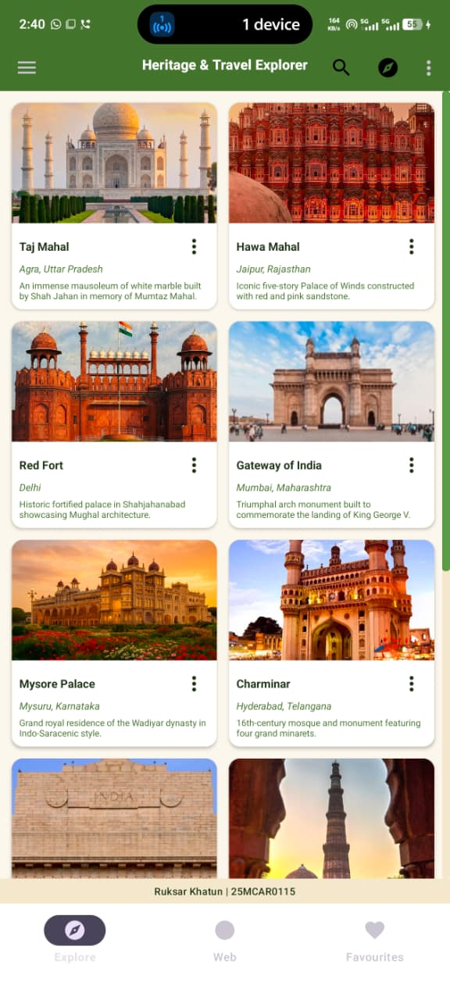
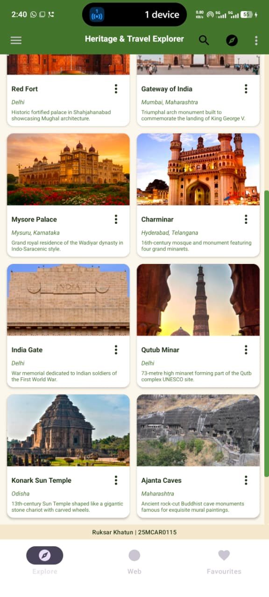
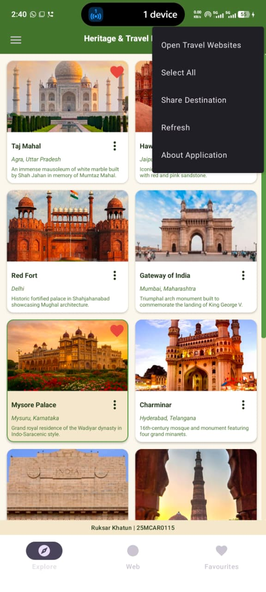
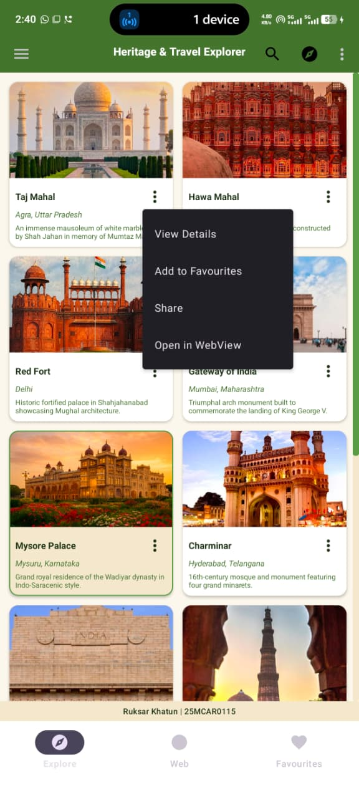
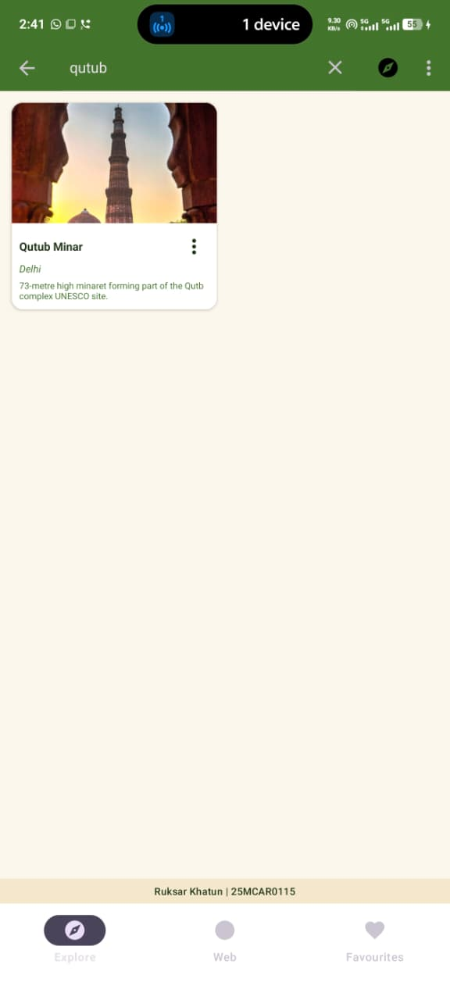
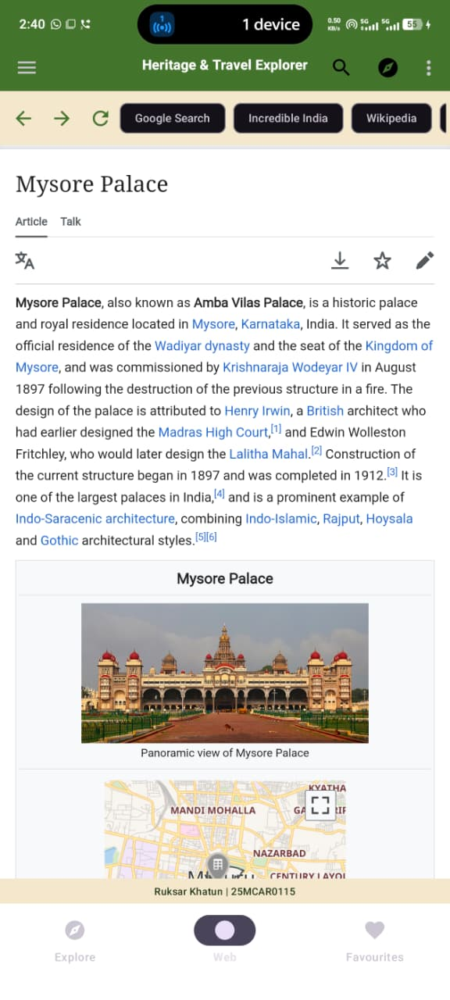
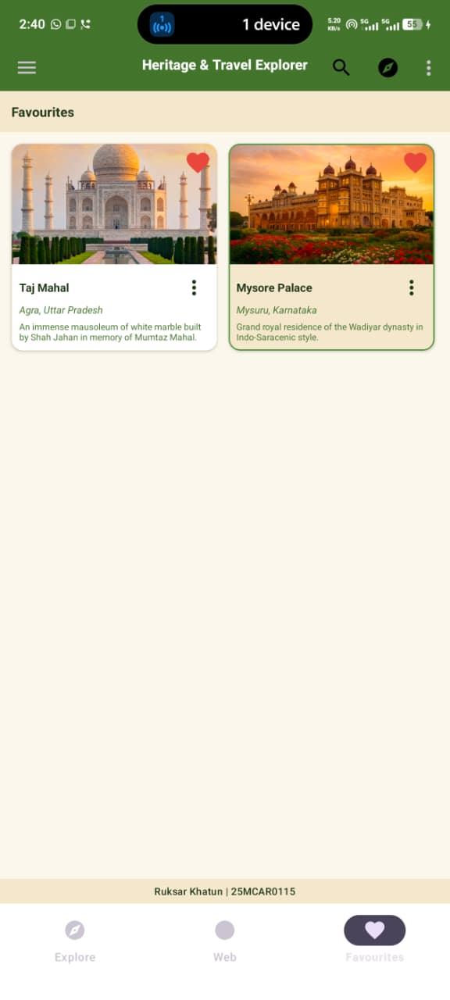

# Experiment 8: Implementation of Android Menus, WebView, RecyclerView and Navigation Components

## 1. Aim

To design, develop, and test an interactive Android application that integrates Android menu components (**Options Menu**, **Context Menu**, and **Popup Menu**), **WebView**, **RecyclerView** with custom adapters, **Navigation Drawer**, and **Bottom Navigation** to deliver a comprehensive digital heritage and travel exploration platform (**Heritage & Travel Explorer**).

---

## 2. Overview

This laboratory experiment demonstrates the design and practical implementation of modern Android user interface components and navigation paradigms. In mobile application development, organizing diverse features—such as data lists, contextual actions, web content, and app-level controls—requires structured navigation models and performant UI components.

To demonstrate these concepts in a practical context, **Heritage & Travel Explorer** was developed as a feature-rich digital travel guide. The application enables users to explore ten prominent Indian heritage sites through a two-column grid gallery, search for destinations dynamically, examine full-screen high-resolution photographs, access AI-powered destination insights using the **Gemini API**, save favourite sites, perform contextual actions via menus, and view web content seamlessly using an embedded **WebView**.

---

## 3. Objectives

The key learning objectives of this experiment are:

1. **Understanding Android Menu Components**: Implementing and distinguishing between the **Options Menu** (app-level actions), **Context Menu** (view-specific long-press actions), and **Popup Menu** (overflow actions anchored to individual card items).
2. **Implementing RecyclerView**: Utilizing `RecyclerView` with a `GridLayoutManager` (2-column layout) and a custom `ListAdapter` with `DiffUtil` for smooth scrolling and memory-efficient view recycling.
3. **Integrating WebView**: Embedding a `WebView` with custom `WebViewClient` and `WebChromeClient` instances to render web pages, handle navigation history, display loading progress, and serve offline local HTML assets.
4. **Implementing Dual Navigation Systems**: Combining a **Navigation Drawer** (`DrawerLayout` + `NavigationView`) and **Bottom Navigation** (`BottomNavigationView`) synchronized with fragment transactions (`FragmentContainerView`).
5. **Data and Resource Management**: Structuring data models to seamlessly handle both local drawable image resources (`R.drawable`) and remote web image URLs using the **Glide** image loading library.
6. **Implementing Search and Favourites**: Adding real-time filtering using `SearchView` and `LiveData` state management in a `ViewModel` architecture, alongside a persistent favourites tracking mechanism.
7. **Interactive Image Viewing**: Implementing a custom `ZoomImageView` using Android `Matrix` transformations, `ScaleGestureDetector`, and `GestureDetector` to provide pinch-to-zoom, drag panning, and double-tap gestures for full-screen photo viewing.
8. **Consistent UI Design**: Applying a unified Green-and-Cream visual theme across all screens and integrating a fixed footer displaying **Ruksar Khatun | 25MCAR0115**.

---

## 4. Software and Hardware Requirements

### 4.1 Software Specifications

| Software / Library | Version / Tool Specification |
|---|---|
| **Operating System** | Microsoft Windows 11 Home (64-bit) |
| **Integrated Development Environment (IDE)** | Android Studio Ladybug Feature Drop \| 2024.2.2 / Studio 2026.1 |
| **Programming Language** | Kotlin (`1.9+` / JVM Target 11) |
| **Build System** | Gradle (`8.x` / Android Gradle Plugin `9.4.1`) |
| **Android SDK Support** | Minimum SDK: `API 24` (Android 7.0 Nougat)<br>Target SDK: `API 37` (Android 15/16)<br>Compile SDK: `API 37` |
| **AndroidX Appcompat** | `1.8.0` |
| **AndroidX Core KTX** | `1.19.1` |
| **Google Material Components** | `1.14.0` |
| **AndroidX Activity KTX** | `1.13.0` |
| **AndroidX ConstraintLayout** | `2.2.2` |
| **Image Loading Library** | Glide `4.16.0` |
| **AI Integration** | Google Gemini REST API (`gemini-1.5-flash`) |

### 4.2 Hardware Specifications

| Component | Minimum Requirement | Recommended Specification |
|---|---|---|
| **Processor** | Intel Core i5 / AMD Ryzen 5 (64-bit) | Intel Core i7 / AMD Ryzen 7 (8+ cores) |
| **System RAM** | 8 GB RAM | 16 GB RAM or higher |
| **Free Disk Space** | 10 GB free space | SSD with 25 GB+ available storage |
| **Display Resolution** | 1280 x 800 pixels | 1920 x 1080 pixels (Full HD) |
| **Target Test Device** | Android Emulator (x86_64) | Physical Android Smartphone / Emulator running Android 10+ (API 29+) |

---

## 5. Theory and Concepts

### 5.1 Android Options Menu
The **Options Menu** is the primary collection of menu items for an activity. It contains actions that have a global impact on the app, such as searching across the database, opening settings, refreshing data, or viewing application details.
* **Working Principle**: Inflated via `onCreateOptionsMenu(menu: Menu)` using a `MenuInflater`. Item selection is handled in `onOptionsItemSelected(item: MenuItem)`.
* **Application Use**: Displays the `SearchView` widget, navigation shortcuts (Home, Web), global multi-selection ("Select All"), app sharing, cache refresh, and the "About Application" dialog.

### 5.2 Context Menu
A **Context Menu** is a floating menu that appears when a user performs a long-press click on a specific element. It provides contextual actions directly relevant to the selected item.
* **Working Principle**: Registered to a view using `registerForContextMenu(view)`. It is created in `onCreateContextMenu(menu, view, menuInfo)` and callbacks are captured in `onContextItemSelected(item: MenuItem)`.
* **Application Use**: When long-pressing any destination card in the gallery, a Context Menu opens displaying options like *View Details*, *Share*, *Copy Destination Name*, *Open Location in Maps*, and *Add/Remove Favourite*.

### 5.3 Popup Menu
A **Popup Menu** displays a vertical list of items anchored to a specific view. It is suitable for providing overflow actions associated with specific content without cluttering the main UI.
* **Working Principle**: Instantiated as `PopupMenu(context, anchorView)` and inflated with `popup.menuInflater.inflate(...)`. Clicks are handled via `setOnMenuItemClickListener`.
* **Application Use**: Anchored to the three-dot overflow icon (`ImageButton`) located at the top-right corner of each destination card. Provides quick access to *View Details*, *Toggle Favourite*, *Share*, and *Open in WebView*.

### 5.4 WebView
`WebView` is an Android `View` component that renders web pages directly inside an Android application using the WebKit rendering engine.
* **Working Principle**: Executes JavaScript via `settings.javaScriptEnabled = true`. `WebViewClient` overrides page loading behavior and captures errors without launching an external web browser. `WebChromeClient` tracks page rendering progress (`onProgressChanged`).
* **Application Use**: Embedded in `WebViewFragment` to render external URLs (Wikipedia, Incredible India, Google Search) and offline local assets (`file:///android_asset/heritage.html`).

### 5.5 RecyclerView
`RecyclerView` is an advanced and flexible version of `ListView`. It efficiently displays large sets of data by reusing (recycling) view items that have scrolled off-screen, thereby drastically reducing memory allocation and CPU overhead.

### 5.6 Adapter and ViewHolder
* **ViewHolder**: Holds references to the individual sub-views within an item layout, eliminating costly `findViewById()` calls during list scrolling.
* **Adapter (`ListAdapter`)**: Acts as a bridge between the underlying data source (`List<Destination>`) and the `RecyclerView`. Utilizing `ListAdapter` alongside `DiffUtil` allows efficient background thread calculation of item differences, animating only changed items rather than triggering full dataset re-binds.

### 5.7 GridLayoutManager
`GridLayoutManager` is a layout manager that arranges `RecyclerView` items in a grid format with a specified span count.
* **Application Use**: Configured with a span count of `2` (`GridLayoutManager(context, 2)`), displaying heritage destination cards side-by-side in a responsive two-column grid.

### 5.8 Navigation Drawer
A slide-in navigation panel (`DrawerLayout` + `NavigationView`) that displays the app's main navigation options from the edge of the screen.
* **Working Principle**: Tied to the action bar/toolbar using `ActionBarDrawerToggle`, providing a synchronized hamburger menu icon that slides open the drawer.

### 5.9 Bottom Navigation
`BottomNavigationView` provides quick access to top-level destinations at the bottom of the screen.
* **Application Use**: Enables one-tap switching between three core fragments: **Explore** (Destination Gallery), **Web** (Integrated Browser), and **Favourites** (Saved Destinations).

### 5.10 Image Loading and Drawable Resources
The application demonstrates dual image loading strategies:
1. **Local Drawable Resources**: High-speed, offline loading from `res/drawable/` using native Android resource IDs (`setImageResource`).
2. **Remote Image Loading (Glide)**: Asynchronous HTTP fetching of remote web image URLs. Glide handles memory caching, disk caching (`DiskCacheStrategy.ALL`), downsampling (`override(400, 300)`), custom user-agent headers (`LazyHeaders`), placeholder rendering (`ic_placeholder`), and error state handling (`ic_error`).

### 5.11 Full-Screen Image Viewer
A custom modal `Dialog` rendering an interactive `ZoomImageView`. Using custom touch event handling, matrix manipulation, and scale gesture listeners, users can zoom in up to 5x magnification, drag/pan across enlarged photographs, or double-tap to toggle zoom levels.

### 5.12 Search and Favourites
* **Search**: Implemented via `SearchView` in the toolbar. It updates a query parameter in `MainViewModel`, triggering dynamic filtering of the `Destination` list.
* **Favourites**: Users can mark any destination as a favourite via Popup Menu, Context Menu, or Details dialog. Favourites are reactively filtered and displayed in `FavouritesFragment`.

---

## 6. Real-World Scenario

The application acts as a digital heritage and travel guide designed to assist tourists, students, and culture enthusiasts in discovering prominent Indian monuments.

### 10-Step User Journey & Responsible Components

```
┌──────────────────────────────────────────────────────────────────────────────────┐
│                             USER JOURNEY WORKFLOW                                │
├─────┬─────────────────────────────────────┬──────────────────────────────────────┤
│ Step│ User Action                         │ Responsible Android Component        │
├─────┼─────────────────────────────────────┼──────────────────────────────────────┤
│  1  │ Opens Explore screen                │ MainActivity + ExploreFragment       │
│  2  │ Views destination gallery           │ RecyclerView + GridLayoutManager     │
│  3  │ Scrolls gallery / searches place    │ SearchView + LiveData + DiffUtil     │
│  4  │ Taps item for details dialog        │ DestinationAdapter + AlertDialog     │
│  5  │ Opens full-screen photo & zooms     │ Dialog + Custom ZoomImageView        │
│  6  │ Adds destination to Favourites      │ ContextMenu / PopupMenu + ViewModel  │
│  7  │ Accesses contextual actions         │ ContextMenu (long-press) / PopupMenu │
│  8  │ Uses app-level menu options         │ OptionsMenu + MaterialToolbar        │
│  9  │ Views web content in-app            │ WebViewFragment + WebView            │
│ 10  │ Switches tabs via bottom bar        │ BottomNavigationView + FragmentTrans │
└─────┴─────────────────────────────────────┴──────────────────────────────────────┘
```

1. **Opening Explore Screen**: Upon launch, `MainActivity` initializes the `FragmentContainerView` and loads `ExploreFragment`.
2. **Browsing Destination Gallery**: The gallery presents ten heritage monuments in a two-column grid rendered by `RecyclerView` with `GridLayoutManager(context, 2)`.
3. **Searching Destinations**: Typing in the `SearchView` invokes `viewModel.setSearchQuery()`. `ExploreFragment` filters the list in real-time.
4. **Viewing Destination Details**: Tapping a card opens a custom `AlertDialog` containing the monument's photograph, location, description, and action buttons.
5. **Examining Photographs**: Tapping the dialog image launches a full-screen `Dialog` containing `ZoomImageView` for pinch-to-zoom and panning.
6. **Adding to Favourites**: Users mark items as favourites. The red heart icon dynamically updates on card items, and items populate the Favourites tab.
7. **Contextual Actions**: Long-pressing a card triggers a `ContextMenu` (*View Details*, *Share*, *Copy Name*, *Open Location in Maps*, *Toggle Favourite*). Tapping the card overflow icon opens a `PopupMenu`.
8. **App-Level Actions**: Using the top `Options Menu`, users can perform searches, select all items, share app details, or view the "About" dialog.
9. **Viewing Web Content**: Clicking "Open in WebView" or "Browse Photos" navigates to `WebViewFragment` to load live URLs or offline local assets (`heritage.html`).
10. **Tab Switching**: Users seamlessly navigate between *Explore*, *Web*, and *Favourites* tabs using `BottomNavigationView` or `NavigationView` (Drawer).

---

## 7. Destination Gallery

The application includes ten curated Indian heritage destinations presented in the following exact order:

| No. | Destination Name | Location | Resource / Loading Strategy |
|:---:|---|---|---|
| **1** | **Taj Mahal** | Agra, Uttar Pradesh | Local Drawable (`R.drawable.taj_mahal`) |
| **2** | **Hawa Mahal** | Jaipur, Rajasthan | Local Drawable (`R.drawable.hawa_mahal`) |
| **3** | **Red Fort** | Delhi | Local Drawable (`R.drawable.red_fort`) |
| **4** | **Gateway of India** | Mumbai, Maharashtra | Local Drawable (`R.drawable.gateway_of_india`) |
| **5** | **Mysore Palace** | Mysuru, Karnataka | Local Drawable (`R.drawable.mysore_palace`) |
| **6** | **Charminar** | Hyderabad, Telangana | Dual: Local (`R.drawable.charminar`) + Remote Unsplash URL |
| **7** | **India Gate** | Delhi | Remote URL (Wikimedia Commons) |
| **8** | **Qutub Minar** | Delhi | Dual: Local (`R.drawable.qutub_minar`) + Remote Unsplash URL |
| **9** | **Konark Sun Temple** | Odisha | Remote URL (Wikimedia Commons) |
| **10** | **Ajanta Caves** | Maharashtra | Remote URL (Wikimedia Commons) |

### Representation & Display Logic
Destinations are represented by the `Destination` Kotlin data class. The `DestinationAdapter` checks `destination.isLocal`:
* If `isLocal == true` and `drawableResId != null`, `binding.ivDestination.setImageResource(...)` is invoked.
* If `isLocal == false` and `imageUrl` is provided, **Glide** fetches the image asynchronously with disk caching and custom headers.

---

## 8. Technology Stack

| Technology / Tool | Category | Role & Purpose in Project |
|---|---|---|
| **Kotlin** | Programming Language | Core application logic, ViewModel state management, and coroutines. |
| **XML** | UI Layout & Styling | Declarative layout definitions, custom styles, themes, vector assets, and menus. |
| **Android Studio** | IDE | Project creation, code editing, layout previewing, debugging, and execution. |
| **Android SDK** | Framework | Provides Android core APIs (SDK API 37, minSdk 24). |
| **RecyclerView** | UI Component | Efficient display of two-column heritage destination card grid. |
| **WebView** | Web Integration | Embedded web rendering for online articles and offline HTML guides. |
| **Glide** | Image Library | Asynchronous image loading, disk caching, and image downsampling (`4.16.0`). |
| **Gradle** | Build System | Dependency management and build task automation (AGP `9.4.1`). |
| **Gemini API** | AI Integration | Generates AI historical overview bullet points and photo search terms (`gemini-1.5-flash`). |

---

## 9. Key Features

1. **Two-Column Destination Gallery**: Responsive grid layout (`GridLayoutManager`) displaying 10 heritage sites.
2. **Real-time Destination Search**: `SearchView` in toolbar filtering by destination name or location.
3. **Options Menu Integration**: App-level actions including Search, Home, Web, Select All, Share, Refresh, and About.
4. **Context Menu & Popup Menu**: Contextual actions accessible via long-press or card overflow three-dot icons.
5. **Destination Details Dialog**: Comprehensive modal dialog displaying high-resolution photos, descriptions, and action buttons.
6. **Full-Screen Image Viewer**: Custom modal overlay displaying uncompressed images with full background dimming.
7. **Pinch-to-Zoom & Pan Gestures**: Custom `ZoomImageView` supporting 1x-5x magnification, pan dragging, and double-tap zoom.
8. **Dual Local & Remote Image Support**: Seamless fallback between local drawables (`res/drawable/`) and remote URLs loaded via Glide.
9. **Favourites Management**: Interactive favourite toggling with a red heart indicator and dedicated Favourites tab.
10. **Integrated WebView Browser**: Full browser controls (Back, Forward, Refresh), chip shortcuts (Google, Wikipedia, Incredible India), progress bar, error layout, and local offline HTML support.
11. **Navigation Drawer**: Slide-out `NavigationView` synchronized with toolbar hamburger toggle.
12. **Bottom Navigation Bar**: One-tap switching between *Explore*, *Web*, and *Favourites* fragments.
13. **Destination Sharing**: Standard Android `Intent.ACTION_SEND` intent sharing destination information.
14. **Gemini AI Insights**: Coroutine-backed REST client calling Google's Gemini API with structured offline fallbacks.
15. **Green-and-Cream Visual Theme**: Sophisticated color palette (`#69994E` primary, `#F2E8D0` surface variant, `#FBF7EE` background).
16. **Fixed Identity Footer**: Persistent bottom banner displaying **Ruksar Khatun | 25MCAR0115**.

---

## 10. Project Folder and File Structure

```
Exp8/
├── .gitignore
├── build.gradle.kts                            # Top-level Gradle configuration
├── gradle.properties                           # Gradle JVM & build settings
├── settings.gradle.kts                         # Subproject inclusion settings
├── screenshots/                                # Output images for documentation
│   ├── img.jpeg                                # Favourites Screen
│   ├── img1.jpeg                               # Options Menu
│   ├── img2.jpeg                               # Search Interface
│   ├── img3.jpeg                               # WebView Integration
│   ├── img4.jpeg                               # Destination Details Dialog
│   ├── img5.jpeg                               # Context Menu
│   ├── img6.jpeg                               # Main Explore Gallery (Top)
│   └── img7.jpeg                               # Explore Gallery (Bottom)
└── app/
    ├── build.gradle.kts                        # Module-level Gradle configuration
    └── src/
        └── main/
            ├── AndroidManifest.xml             # App permissions & activity registration
            ├── assets/
            │   └── heritage.html               # Offline HTML heritage guide asset
            ├── java/com/example/exp8/
            │   ├── Destination.kt              # Data class representing a heritage site
            │   ├── DestinationAdapter.kt       # RecyclerView ListAdapter with DiffUtil
            │   ├── ExploreFragment.kt          # Main destination gallery fragment
            │   ├── FavouritesFragment.kt       # Saved destinations fragment
            │   ├── GeminiService.kt            # Gemini AI HTTP REST client & fallbacks
            │   ├── MainActivity.kt             # Main entry activity managing navigation
            │   ├── MainViewModel.kt            # Shared ViewModel for state management
            │   ├── WebViewFragment.kt          # Embedded browser fragment
            │   └── ZoomImageView.kt            # Custom ImageView supporting pinch-to-zoom
            └── res/
                ├── drawable/                   # Images & vector icons
                │   ├── charminar.jpg
                │   ├── gateway_of_india.jpg
                │   ├── hawa_mahal.jpg
                │   ├── mysore_palace.jpg
                │   ├── qutub_minar.jpg
                │   ├── red_fort.jpg
                │   ├── taj_mahal.jpg
                │   └── ic_*.xml (explore, web, favourite, search, etc.)
                ├── drawable-nodpi/             # High-res drawables (ajanta, india_gate, konark)
                ├── layout/                     # XML UI Layouts
                │   ├── activity_main.xml       # Main layout (Drawer + Toolbar + Container + Footer + BottomNav)
                │   ├── dialog_destination_details.xml # Details modal layout
                │   ├── dialog_full_screen_image.xml  # Full-screen photo viewer layout
                │   ├── fragment_explore.xml    # Gallery fragment layout
                │   ├── fragment_favourites.xml # Favourites fragment layout
                │   ├── fragment_web_view.xml   # Browser fragment layout
                │   ├── item_destination.xml    # RecyclerView destination card layout
                │   └── nav_header.xml          # Navigation Drawer header
                ├── menu/                       # XML Menu Definitions
                │   ├── bottom_nav_menu.xml     # Bottom navigation items
                │   ├── context_menu.xml        # Card long-press context menu
                │   ├── main_options_menu.xml   # Top app-bar options menu
                │   ├── nav_drawer_menu.xml     # Navigation drawer items
                │   └── popup_menu.xml          # Card overflow popup menu
                └── values/                     # Strings, colors, and themes
                    ├── colors.xml              # Green-and-Cream color palette definitions
                    ├── strings.xml             # App string resources & student name
                    └── themes.xml              # Material3 NoActionBar theme setup
```

---

## 11. Implementation Details

### 11.1 Destination Data Model (`Destination.kt`)
Represents individual heritage destinations:
```kotlin
package com.example.exp8

data class Destination(
    val id: Int,
    val name: String,
    val location: String,
    val description: String,
    val isLocal: Boolean,
    val drawableResId: Int? = null,
    val imageUrl: String? = null,
    val webUrl: String,
    var isFavourite: Boolean = false,
    var isSelected: Boolean = false
)
```

### 11.2 ViewModel State Management (`MainViewModel.kt`)
Centralizes app state, handling destination list mutations, search query filter states, and active web URLs using `LiveData`:
```kotlin
class MainViewModel : ViewModel() {
    private val _destinations = MutableLiveData<List<Destination>>(initialDestinations)
    val destinations: LiveData<List<Destination>> = _destinations

    private val _searchQuery = MutableLiveData<String>("")
    val searchQuery: LiveData<String> = _searchQuery

    private val _activeWebUrl = MutableLiveData<String>("https://www.google.com")
    val activeWebUrl: LiveData<String> = _activeWebUrl

    fun toggleFavourite(destinationId: Int) {
        val currentList = _destinations.value ?: return
        _destinations.value = currentList.map {
            if (it.id == destinationId) it.copy(isFavourite = !it.isFavourite) else it
        }
    }
}
```

### 11.3 RecyclerView Adapter & View Recycling (`DestinationAdapter.kt`)
Uses `ListAdapter` and `Glide` for efficient view recycling and dual image source handling:
```kotlin
override fun onBindViewHolder(holder: DestinationViewHolder, position: Int) {
    val destination = getItem(position)
    if (destination.isLocal && destination.drawableResId != null) {
        binding.ivDestination.setImageResource(destination.drawableResId)
    } else if (!destination.imageUrl.isNullOrEmpty()) {
        Glide.with(context)
            .load(GlideUrl(destination.imageUrl, LazyHeaders.Builder().addHeader("User-Agent", "...").build()))
            .override(400, 300)
            .centerCrop()
            .diskCacheStrategy(DiskCacheStrategy.ALL)
            .placeholder(R.drawable.ic_placeholder)
            .into(binding.ivDestination)
    }
}
```

### 11.4 Menu Handling in Fragments (`ExploreFragment.kt`)
Inflation and event handling for Context Menu and Popup Menu:
```kotlin
private fun showPopupMenu(destination: Destination, anchorView: View) {
    val popup = PopupMenu(requireContext(), anchorView)
    popup.menuInflater.inflate(R.menu.popup_menu, popup.menu)
    popup.setOnMenuItemClickListener { menuItem ->
        when (menuItem.itemId) {
            R.id.pop_view_details -> { showDestinationDetailsDialog(destination); true }
            R.id.pop_toggle_favourite -> { viewModel.toggleFavourite(destination.id); true }
            R.id.pop_open_web -> {
                viewModel.openInWeb(destination.webUrl)
                (activity as? MainActivity)?.navigateToTab(R.id.nav_web)
                true
            }
            else -> false
        }
    }
    popup.show()
}
```

### 11.5 Embedded WebView Setup (`WebViewFragment.kt`)
Configures `WebView` with JavaScript, progress tracking, and internal page loading:
```kotlin
@SuppressLint("SetJavaScriptEnabled")
private fun setupWebView() {
    binding.webView.settings.apply {
        javaScriptEnabled = true
        domStorageEnabled = true
        builtInZoomControls = true
    }
    binding.webView.webChromeClient = object : WebChromeClient() {
        override fun onProgressChanged(view: WebView?, newProgress: Int) {
            binding.pbLoading.progress = newProgress
            binding.pbLoading.visibility = if (newProgress < 100) View.VISIBLE else View.GONE
        }
    }
}
```

---

## 12. Working Procedure

Follow these steps to build, run, and test the application:

1. **Open Project**: Launch Android Studio and open the project directory `Exp8`.
2. **Gradle Sync**: Select **File > Sync Project with Gradle Files** to download dependencies (Material, Glide, AndroidX).
3. **Select Target**: Select an Android Virtual Device (Emulator) or connect a physical Android device via USB debugging.
4. **Build and Run**: Click **Run > Run 'app'** (`Shift + F10`) to compile and install the APK.
5. **Test Explore Gallery**: Observe the 2-column grid displaying 10 heritage sites with local and online photographs.
6. **Test Search**: Tap the search icon in the top options menu and type `"Qutub"` or `"Delhi"` to test real-time filtering.
7. **Test Options Menu**: Tap the overflow menu (three vertical dots) in the toolbar to test *Select All*, *Share Application*, *Refresh*, and *About Application*.
8. **Test Context Menu**: Long-press any destination card to open the floating context menu (*View Details*, *Share*, *Copy Name*, *Open Location*, *Toggle Favourite*).
9. **Test Popup Menu**: Tap the three-dot overflow button on a card to open the popup menu.
10. **Test Details Dialog**: Click on a destination card to view its description, image, and Gemini AI Insights button.
11. **Test Full-Screen Zoom**: Click on the image inside the details dialog or card to launch the full-screen photo viewer. Test pinch-to-zoom and double-tap gestures.
12. **Test Favourites**: Mark destinations as favourites and navigate to the **Favourites** tab using the bottom navigation bar to verify saved items.
13. **Test WebView**: Tap the **Web** tab or click "Open in WebView" on any destination to test browser navigation, quick action chips, and the offline HTML guide.
14. **Test Navigation Drawer**: Swipe from the left edge or tap the hamburger icon in the toolbar to open the navigation drawer.

---

## 13. Application Output

### 13.1 Explore Gallery — Top


*Figure 1: Main Explore screen displaying the heritage destination gallery.*

### 13.2 Explore Gallery — Bottom


*Figure 2: Lower gallery section demonstrating scrolling and additional destination cards.*

### 13.3 Options Menu


*Figure 3: Options Menu providing access to application-level actions.*

### 13.4 Context Menu


*Figure 4: Contextual actions available for an individual destination.*

### 13.5 Destination Details


*Figure 5: Destination details dialog with photograph, description, and available actions.*

### 13.6 Search Functionality


*Figure 6: Search interface displaying the matching Qutub Minar destination.*

### 13.7 WebView Integration


*Figure 7: Integrated WebView displaying heritage-related web content.*

### 13.8 Favourites


*Figure 8: Favourites section displaying saved destinations.*

---

## 14. Learning Outcomes

Through the completion of this experiment, the following practical skills and concepts were acquired:

1. **Mastery of Android Menu Paradigms**: Practical expertise in defining and handling Options Menus, Context Menus, and Popup Menus in XML and Kotlin.
2. **Efficient List Rendering**: Utilizing `RecyclerView`, `GridLayoutManager`, `ListAdapter`, and `DiffUtil` for memory-efficient view recycling and UI performance optimization.
3. **Web Integration in Android**: Configuring `WebView`, `WebViewClient`, `WebChromeClient`, handling back-stack history, and loading both remote web URLs and local offline assets.
4. **Modern Navigation Patterns**: Combining `Navigation Drawer` and `Bottom Navigation` seamlessly within a single activity using Fragment transactions.
5. **State Management with Jetpack Architecture**: Implementing `ViewModel` and `LiveData` to maintain UI state, search filtering, and dataset mutations across configuration changes.
6. **Advanced Image Handling & Touch Gestures**: Utilizing `Glide` for asynchronous image caching and developing custom touch-handling views (`ZoomImageView`) for pinch-to-zoom functionality.

---

## 15. Result

The Android application **Heritage & Travel Explorer** was successfully implemented, compiled, and verified on an Android device/emulator. All core requirements—including Android Options Menu, Context Menu, Popup Menu, RecyclerView grid presentation, integrated WebView, Favourites management, Navigation Drawer, Bottom Navigation, and the identity footer displaying **Ruksar Khatun | 25MCAR0115**—were fully functional and validated against the experimental objectives.

---

## 16. Conclusion

This experiment demonstrates the effective integration of fundamental Android UI components and navigation patterns to create a cohesive, real-world mobile application. By combining **RecyclerView** for structured data presentation, **WebView** for integrated web content, multiple **Menu** types for flexible user interactions, and dual navigation frameworks (**Navigation Drawer** and **Bottom Navigation**), the project illustrates best practices in Android application architecture, performance optimization, and user interface design.

---
*Experiment 8 Laboratory Report | MCA Program*
