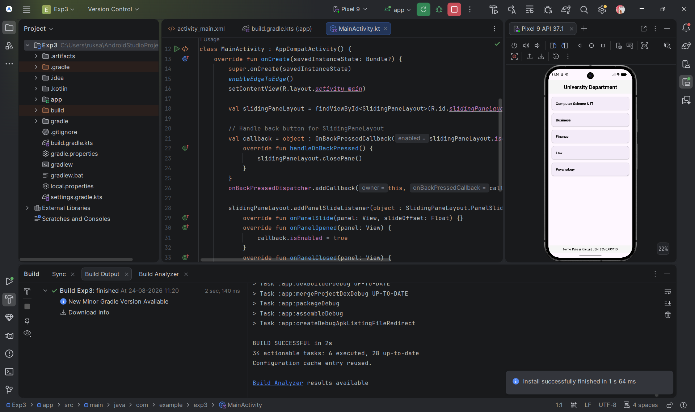

# Experiment 1: Develop a simple "Hello World" Android application

## Overview
This project is the first experiment in the MAD (Mobile Application Development) Lab. The goal is to set up the Android development environment and create a basic application that displays text on the screen. It serves as a foundation for understanding project configuration, UI design using XML, and activity lifecycle in Android.

## Experiment Documentation

### Concept and Technology
The experiment utilizes the following core Android technologies:
- **Android Studio**: The official Integrated Development Environment (IDE) for Android app development.
- **Kotlin**: A modern, statically typed programming language used for Android development.
- **Android XML (Extensible Markup Language)**: Used to define the layout and UI components of the application.
- **ConstraintLayout**: A flexible layout manager that allows positioning and sizing widgets in a relative manner.
- **Gradle**: The build system used by Android Studio to compile and package the application.

### Scenario
The scenario for this experiment is to develop a personalized "Hello World" application. Instead of just a generic message, the app is designed to display the student's name and registration number. The UI is structured to show three distinct pieces of information centered vertically:
1.  A greeting message: **"Hello World!"**
2.  The student's name: **Ruksar Khatun**
3.  The student's registration ID: **25MCAR0115**

All text elements are styled as **bold** and arranged using a packed vertical chain to ensure they appear as a single group in the center of the display.

## Project Structure Breakdown

The following tree describes the organized structure of the project files:

```text
Exp1/
├── app/                        # Main module containing source code and resources
│   ├── src/                    # Source directory
│   │   ├── main/               # Main source set (production code)
│   │   │   ├── java/           # Java/Kotlin source files
│   │   │   │   └── com/example/exp1/
│   │   │   │       └── MainActivity.kt      # The main activity class
│   │   │   ├── res/            # Resource files
│   │   │   │   └── layout/
│   │   │   │       └── activity_main.xml    # The UI layout file for the main screen
│   │   │   └── AndroidManifest.xml          # Essential information about the app for the Android system
│   └── build.gradle.kts        # Module-specific build configuration
├── img.png                     # Visual output of the application
├── build.gradle.kts            # Project-wide build configuration
├── settings.gradle.kts         # Project settings including module definitions
└── README.md                   # This documentation file
```

## Source Code

### UI Definition (`activity_main.xml`)
```xml
<?xml version="1.0" encoding="utf-8"?>
<androidx.constraintlayout.widget.ConstraintLayout xmlns:android="http://schemas.android.com/apk/res/android"
    xmlns:app="http://schemas.android.com/apk/res-auto"
    xmlns:tools="http://schemas.android.com/tools"
    android:id="@+id/main"
    android:layout_width="match_parent"
    android:layout_height="match_parent"
    tools:context=".MainActivity">

    <TextView
        android:id="@+id/tv_hello"
        android:layout_width="wrap_content"
        android:layout_height="wrap_content"
        android:text="Hello World!"
        android:textStyle="bold"
        app:layout_constraintBottom_toTopOf="@+id/tv_name"
        app:layout_constraintEnd_toEndOf="parent"
        app:layout_constraintStart_toStartOf="parent"
        app:layout_constraintTop_toTopOf="parent"
        app:layout_constraintVertical_chainStyle="packed" />

    <TextView
        android:id="@+id/tv_name"
        android:layout_width="wrap_content"
        android:layout_height="wrap_content"
        android:text="Ruksar Khatun"
        android:textStyle="bold"
        android:layout_marginTop="8dp"
        app:layout_constraintBottom_toTopOf="@+id/tv_id"
        app:layout_constraintEnd_toEndOf="parent"
        app:layout_constraintStart_toStartOf="parent"
        app:layout_constraintTop_toBottomOf="@+id/tv_hello" />

    <TextView
        android:id="@+id/tv_id"
        android:layout_width="wrap_content"
        android:layout_height="wrap_content"
        android:text="25MCAR0115"
        android:textStyle="bold"
        android:layout_marginTop="8dp"
        app:layout_constraintBottom_toBottomOf="parent"
        app:layout_constraintEnd_toEndOf="parent"
        app:layout_constraintStart_toStartOf="parent"
        app:layout_constraintTop_toBottomOf="@+id/tv_name" />

</androidx.constraintlayout.widget.ConstraintLayout>
```

### Logical Implementation (`MainActivity.kt`)
```kotlin
package com.example.exp1

import android.os.Bundle
import androidx.activity.enableEdgeToEdge
import androidx.appcompat.app.AppCompatActivity
import androidx.core.view.ViewCompat
import androidx.core.view.WindowInsetsCompat

class MainActivity : AppCompatActivity() {
    override fun onCreate(savedInstanceState: Bundle?) {
        super.onCreate(savedInstanceState)
        enableEdgeToEdge()
        setContentView(R.layout.activity_main)
        ViewCompat.setOnApplyWindowInsetsListener(findViewById(R.id.main)) { v, insets ->
            val systemBars = insets.getInsets(WindowInsetsCompat.Type.systemBars())
            v.setPadding(systemBars.left, systemBars.top, systemBars.right, systemBars.bottom)
            insets
        }
    }
}
```

## Experiment Output
The image below shows the final output of the experiment when run on an Android device/emulator. It displays the "Hello World!" message along with the developer's name and ID.


_This is the output of the Experiment One._
