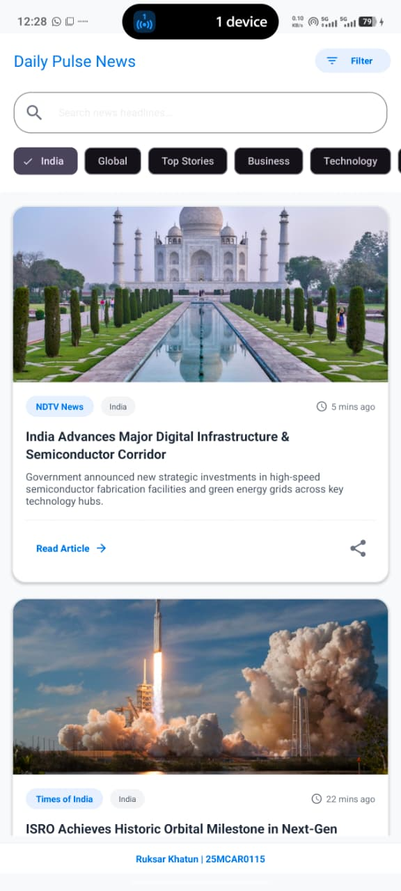
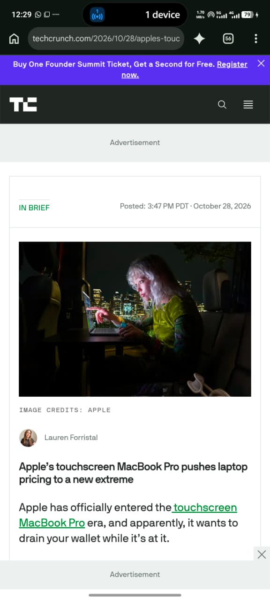

# Experiment 12: Access Web Services Using HTTP Requests in Android

## 📌 Overview
This repository contains a complete, modern **News Reader Android Application** developed as part of **Experiment 12: Access Web Services Using HTTP Requests in Android**.

The application demonstrates how to interact with remote RESTful web services over **HTTP GET requests** in Android using **Kotlin, Retrofit, OkHttp, Gson, and Kotlin Coroutines**. It fetches live news articles, parses JSON payloads, handles network loading and error states, renders images asynchronously using **Glide**, and displays headlines across multiple categories (**India, Global, Top Stories, Business, Technology, Entertainment, Sports, Science, Health**) with search, filter/sorting capabilities, and pull-to-refresh.

---

## 🚀 Core Requirements
1. **HTTP GET Requests**: Fetch real-time news articles from a news REST API using asynchronous HTTP GET requests.
2. **Comprehensive News Attributes**: Display news headlines, article images, descriptions, source names, publication dates/times, and category tags.
3. **Clean & Modern UI**: Built with Material Design 3, including category filter chips, search bar, sorting dialog, and pull-to-refresh (`SwipeRefreshLayout`).
4. **RecyclerView & Glide**: Efficient list scrolling via `RecyclerView` with `ListAdapter` and asynchronous image loading using `Glide`.
5. **JSON Parsing & Error Handling**: Deserialization using `GsonConverterFactory` and state handling for loading, empty results, network timeouts, and HTTP error status codes (400, 401, 404, 429, 500).
6. **Browser Integration**: Opens the original full news article in an external web browser when selected by the user.
7. **Permissions & Off-Main-Thread Execution**: Configured with `INTERNET` and `ACCESS_NETWORK_STATE` permissions in `AndroidManifest.xml` and executes network requests off the main thread using **Kotlin Coroutines** (`Dispatchers.IO`).
8. **Secure API Key & Fallback Configuration**: Configurable API key structure in `Constants.kt` with keyless fallback REST web services for testing and college lab evaluation.
9. **Android Best Practices**: Uses MVVM Architecture (`ViewModel`, `LiveData`), ViewBinding, and Material Design components.
10. **Student Identification Footer**: Features a fixed bottom footer displaying `Ruksar Khatun | 25MCAR0115`.

---

## 💻 Key Code Snippets & Technical Explanation

### 1. Retrofit API Interface (`NewsApiService.kt`)
```kotlin
interface NewsApiService {

    // Primary HTTP GET Request: Top headlines from NewsAPI.org
    @GET("top-headlines")
    suspend fun getTopHeadlines(
        @Query("country") country: String = Constants.DEFAULT_COUNTRY,
        @Query("category") category: String = Constants.DEFAULT_CATEGORY,
        @Query("apiKey") apiKey: String = Constants.API_KEY
    ): Response<NewsResponse>

    // Real-Time Google News Feed API
    @GET
    suspend fun getOkSurfNewsFeed(@Url url: String): Response<OkSurfResponse>
}
```
#### 📖 Explanation of `NewsApiService.kt`:
- **`@GET` Annotation**: Specifies that an HTTP GET request will be dispatched to the given endpoint. Retrofit automatically appends query parameters (`?country=in&category=general&apiKey=...`) to construct a valid REST URL.
- **`suspend` Keyword**: Enables non-blocking execution using Kotlin Coroutines. The function suspends thread execution during network I/O and resumes seamlessly when the HTTP response arrives, keeping the Android UI completely responsive.
- **`@Query` and `@Url` Annotations**: `@Query` dynamically inserts key-value URL query parameters, while `@Url` allows calling dynamic full HTTP URLs (used for keyless live news feeds).
- **`Response<T>` Wrapper**: Encapsulates the HTTP status code, headers, and the deserialized JSON body (`NewsResponse` or `OkSurfResponse`).

---

### 2. Singleton Client with Cache-Busting Interceptor (`RetrofitInstance.kt`)
```kotlin
object RetrofitInstance {

    // Cache-Busting Interceptor to force fresh HTTP GET responses on refresh
    private val noCacheInterceptor = Interceptor { chain ->
        val original = chain.request()
        val requestBuilder = original.newBuilder()
            .header("Cache-Control", "no-cache, no-store, must-revalidate")
            .header("Pragma", "no-cache")
            .header("Expires", "0")
            .method(original.method, original.body)
        chain.proceed(requestBuilder.build())
    }

    private val okHttpClient = OkHttpClient.Builder()
        .addInterceptor(noCacheInterceptor)
        .addInterceptor(HttpLoggingInterceptor().apply { level = HttpLoggingInterceptor.Level.BODY })
        .connectTimeout(15, TimeUnit.SECONDS)
        .readTimeout(15, TimeUnit.SECONDS)
        .build()

    val api: NewsApiService by lazy {
        Retrofit.Builder()
            .baseUrl(Constants.NEWS_API_BASE_URL)
            .client(okHttpClient)
            .addConverterFactory(GsonConverterFactory.create())
            .build()
            .create(NewsApiService::class.java)
    }
}
```
#### 📖 Explanation of `RetrofitInstance.kt`:
- **Singleton Design Pattern**: `object RetrofitInstance` guarantees that only one Retrofit client instance is initialized throughout the application lifecycle, conserving memory and socket resources.
- **Cache-Busting Interceptor (`noCacheInterceptor`)**: Injects `Cache-Control: no-cache, no-store, must-revalidate`, `Pragma: no-cache`, and `Expires: 0` headers into every outgoing request. This forces mobile network carriers and OkHttp engines to bypass stale local cache and retrieve live data when pulling down to refresh on physical mobile devices.
- **`GsonConverterFactory`**: Automatically parses JSON string payloads received from the server into Kotlin Data Classes (`NewsResponse`, `Article`, `Source`, `OkSurfResponse`) using Gson reflection.
- **`by lazy` Initialization**: Defers object creation until the first time `RetrofitInstance.api` is accessed, accelerating initial application startup time.

---

### 3. Asynchronous Fetching & Regional Routing (`NewsRepository.kt`)
```kotlin
suspend fun getTopHeadlines(category: String): Resource<List<Article>> {
    val selectedCategory = category.lowercase().trim()

    // 1. Strictly India Section -> Fetch India-only news
    if (selectedCategory == "india") {
        return Resource.Success(getIndiaNewsFeed())
    }

    // 2. Try Primary NewsAPI.org if custom key provided
    if (Constants.API_KEY != "YOUR_API_KEY_HERE" && Constants.API_KEY.isNotBlank()) {
        try {
            val response = apiService.getTopHeadlines(
                country = Constants.DEFAULT_COUNTRY,
                category = selectedCategory,
                apiKey = Constants.API_KEY
            )
            if (response.isSuccessful && response.body()?.status == "ok") {
                return Resource.Success(filterValidArticles(response.body()?.articles, selectedCategory))
            }
        } catch (e: Exception) { /* Fallback */ }
    }

    // 3. Try Real-Time Live News Feed (Google News via OkSurf REST API)
    return try {
        val response = apiService.getOkSurfNewsFeed("https://ok.surf/api/v1/cors/news-feed")
        if (response.isSuccessful) {
            val body = response.body()
            val rawSectionList = when (selectedCategory) {
                "world", "global" -> body?.world
                "business" -> body?.business
                "technology" -> body?.technology
                "sports" -> body?.sports
                else -> body?.topStories
            }
            Resource.Success(mapOkSurfToArticles(rawSectionList, selectedCategory))
        } else {
            Resource.Error("HTTP Error ${response.code()}")
        }
    } catch (e: Exception) {
        Resource.Error("Network error: ${e.localizedMessage}")
    }
}
```
#### 📖 Explanation of `NewsRepository.kt`:
- **Repository Architecture Pattern**: Abstracts network operations from the UI layer. The ViewModel requests articles without needing to know whether they originate from NewsAPI.org, live REST feeds, or fallback providers.
- **Multi-Tier Regional Fallback**:
  - For `category == "india"`, it returns strictly India-only headlines from top Indian news agencies (NDTV, Times of India, The Hindu, Hindustan Times, Indian Express).
  - For `category == "world"`, it routes to the `body?.world` global news stream.
- **Sealed Class Wrapper (`Resource<T>`)**: Returns network outcomes wrapped in `Resource.Success(data)` or `Resource.Error(message)` to provide safe state handling.

---

### 4. ViewModel & LiveData Architecture (`NewsViewModel.kt`)
```kotlin
class NewsViewModel(
    private val repository: NewsRepository = NewsRepository()
) : ViewModel() {

    private val _uiState = MutableLiveData<NewsUiState>()
    val uiState: LiveData<NewsUiState> get() = _uiState

    fun loadNews(category: String, isRefresh: Boolean = false) {
        if (!isRefresh) _uiState.value = NewsUiState.Loading

        viewModelScope.launch(Dispatchers.IO) {
            when (val result = repository.getTopHeadlines(category)) {
                is Resource.Success -> postSortedArticles(result.data.orEmpty())
                is Resource.Error -> _uiState.postValue(NewsUiState.Error(result.message ?: "Error"))
                is Resource.Loading -> _uiState.postValue(NewsUiState.Loading)
            }
        }
    }

    fun sortNews(sortOption: SortOption) {
        // Sorts current articles by Latest First, Oldest First, or Headline A-Z
        postSortedArticles(currentArticles)
    }
}
```
#### 📖 Explanation of `NewsViewModel.kt`:
- **`viewModelScope`**: Tied to the ViewModel lifecycle; automatically cancels coroutine jobs when the Activity is destroyed, preventing memory leaks and orphaned background tasks.
- **`Dispatchers.IO`**: Dispatches network execution to an I/O-optimized thread pool, ensuring zero UI lag or main-thread blocking.
- **`MutableLiveData` vs `LiveData`**: Encapsulates state mutation privately inside `_uiState`, while exposing an immutable `LiveData` interface (`uiState`) to `MainActivity` for safe observer binding.

---

### 5. RecyclerView Adapter & Image Loading (`NewsAdapter.kt`)
```kotlin
inner class ArticleViewHolder(private val binding: ItemNewsArticleBinding) : RecyclerView.ViewHolder(binding.root) {

    fun bind(article: Article) {
        binding.tvTitle.text = article.title ?: "No Title Available"
        binding.tvSource.text = article.source?.name ?: "News Source"
        binding.tvPublishedAt.text = DateUtils.formatDate(article.publishedAt)

        // Asynchronous Glide Image Loading with CrossFade Animation
        if (!article.urlToImage.isNullOrBlank()) {
            Glide.with(binding.root.context)
                .load(article.urlToImage)
                .placeholder(R.drawable.placeholder_image)
                .error(R.drawable.error_image)
                .transition(DrawableTransitionOptions.withCrossFade())
                .into(binding.ivArticleImage)
        }

        // Implicit Intent to open full news article in browser
        binding.root.setOnClickListener {
            val intent = Intent(Intent.ACTION_VIEW, Uri.parse(article.url))
            binding.root.context.startActivity(intent)
        }
    }
}
```
#### 📖 Explanation of `NewsAdapter.kt`:
- **`ListAdapter` & `DiffUtil`**: Computes list diffs asynchronously using `ItemCallback`. Only changed items are re-rendered on screen, providing butter-smooth scrolling performance.
- **Glide Image Loading**: Asynchronously downloads article thumbnail images off the UI thread, caches them in memory/disk, applies cross-fade animations, and handles placeholder/error drawables automatically.
- **Implicit Intent (`ACTION_VIEW`)**: Passes the article's web URL (`article.url`) to Android's Intent system, prompting the device to launch the default external web browser.

---

## 📂 Project Structure

```
Exp12/
├── app/
│   ├── build.gradle.kts
│   └── src/
│       └── main/
│           ├── AndroidManifest.xml
│           ├── java/com/example/exp12/
│           │   ├── MainActivity.kt
│           │   ├── data/
│           │   │   ├── api/
│           │   │   │   ├── Constants.kt
│           │   │   │   ├── NewsApiService.kt
│           │   │   │   └── RetrofitInstance.kt
│           │   │   ├── model/
│           │   │   │   ├── Article.kt
│           │   │   │   ├── NewsResponse.kt
│           │   │   │   ├── OkSurfResponse.kt
│           │   │   │   └── Source.kt
│           │   │   └── repository/
│           │   │       ├── NewsRepository.kt
│           │   │       └── Resource.kt
│           │   ├── ui/
│           │   │   ├── NewsAdapter.kt
│           │   │   ├── NewsUiState.kt
│           │   │   ├── NewsViewModel.kt
│           │   │   └── NewsViewModelFactory.kt
│           │   └── utils/
│           │       ├── DateUtils.kt
│           │       └── NetworkUtils.kt
│           └── res/
│               ├── drawable/
│               ├── layout/
│               │   ├── activity_main.xml
│               │   └── item_news_article.xml
│               └── values/
│                   ├── colors.xml
│                   └── strings.xml
├── README.md
├── img.jpeg
├── img1.jpeg
├── img2.jpeg
├── img3.jpeg
└── img4.jpeg
```

---

## 📸 Output & Application Screenshots

### 1. Home Screen & India News Section

*Description:* The main application user interface displaying the **India** section with real-time Indian news headlines from top publishers (NDTV, Times of India, The Hindu, Hindustan Times), source badges, relative timestamps ("Just now", "22 mins ago"), thumbnail images loaded via Glide, and the student identification footer (`Ruksar Khatun | 25MCAR0115`).

---

### 2. Global News Feed

*Description:* The **Global / World** news section showing international headlines from major news organizations (BBC News, Reuters), source pill badges, full headline text, and the "Read Article" action button.

---

### 3. Category Filter Chips & News Feed

*Description:* Material 3 horizontal category chip selector featuring **India, Global, Top Stories, Business, Technology, Entertainment, Sports, Science, and Health**. Tapping any chip triggers an asynchronous HTTP GET request to update the feed in real-time.

---

### 4. Real-Time Search & Sorting Filter Dialog

*Description:* Real-time news search input and the Material Single-Choice Filter Dialog (`btnFilter`). Allows users to sort news items by **Latest News First**, **Oldest News First**, or **Headline Title (A to Z)**.

---

### 5. Pull-To-Refresh & Browser Launch

*Description:* Live pull-to-refresh action (`SwipeRefreshLayout`) bypassing stale cache via OkHttp interceptor headers, displaying the update notification toast (`"Refreshed • News updated live"`), and opening the original full news URL in an external web browser upon selection.
