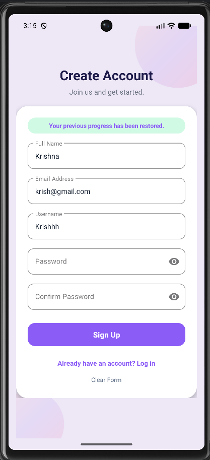
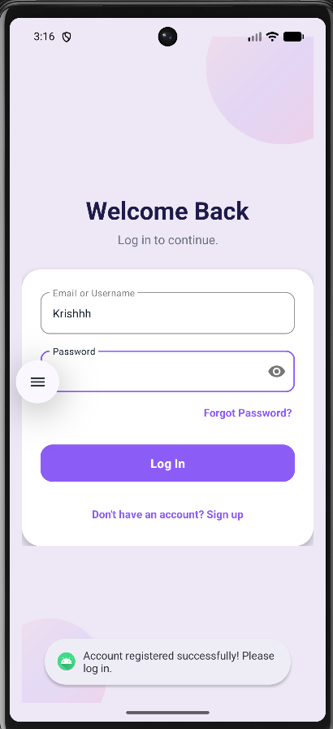
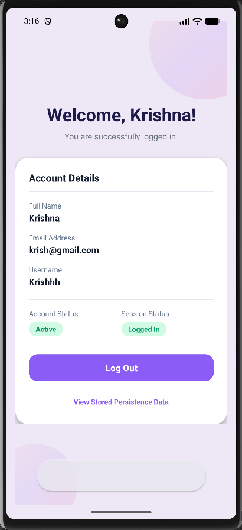
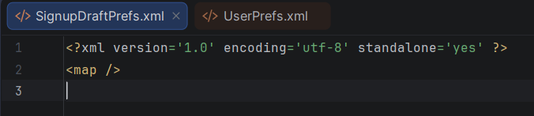

# Experiment 9: Login, Registration and Data Persistence

An Android application developed in Android Studio using Kotlin, XML layouts, SQLite Database, and SharedPreferences to demonstrate secure user authentication, form draft restoration, and persistent session management.

---

## Project Overview

This project demonstrates local data persistence and state management in an Android application built with the Empty Views Activity template. The application features:

- **User Registration & Login Authentication:** Complete user onboarding with validation.
- **Input Validation & Account Creation:** Strict checks for missing fields, valid email formatting, password strength, and duplicate prevention.
- **SQLite-Based Storage:** Permanent on-device database storage for registered user profiles.
- **SharedPreferences Session Management:** Persistent login sessions across application restarts.
- **Registration Progress Restoration:** Automatic draft saving and state recovery for unfinished registration forms.
- **Data Persistence Across App Restarts:** User sessions and database records survive application closure, task clearing, and device reboots.

---

## Objectives

- Implement a secure user registration and login authentication workflow.
- Validate user inputs prior to database insertion.
- Store registered user credentials locally using an SQLite database (`SQLiteOpenHelper`).
- Maintain user login sessions across app lifecycles using `SharedPreferences`.
- Automatically save and restore unfinished registration draft progress upon application reopening.
- Demonstrate modern UI design principles using Material Design, XML layouts, and custom view drawables.

---

## Technologies Used

| Technology | Purpose |
|---|---|
| Kotlin | Primary programming language for application and business logic |
| XML | User interface layout design and drawable resource styling |
| Android Studio | Integrated Development Environment (IDE) |
| SQLite | Local relational database for persistent user record storage |
| SharedPreferences | Local key-value storage for active session state and form drafts |
| Android SDK | Core Android application framework and Activity APIs |

---

## Application Screenshots

### 1. Registration Screen

*Figure 1: Registration Screen featuring modern input fields, password visibility toggles, and automatic draft restoration.*

- **Functionality:** Provides input fields for Full Name, Email Address, Username, Password, and Confirm Password. Includes a prominent **Sign Up** action button, **Log in** navigation link, and a **Clear Form** option.
- **Highlight:** The green banner ("*Your previous progress has been restored.*") indicates that previously entered non-sensitive form entries were automatically saved and restored when reopening the screen. Passwords are omitted from saved drafts for security and must be re-entered.

---

### 2. Login Screen

*Figure 2: Login Screen with credential pre-filling and instant Toast feedback after registration.*

- **Functionality:** Allows registered users to authenticate using either their registered Email Address or Username along with their Password. Features end-icon password visibility toggling and navigation to the Sign-Up screen.
- **Highlight:** Demonstrates smooth workflow transition after registration. The newly created username is pre-filled automatically, accompanied by confirmation feedback.

---

### 3. Dashboard Screen

*Figure 3: Dashboard Screen displaying user account details, active status indicators, and persistence viewer.*

- **Functionality:** Displays a prominent welcome heading addressed to the authenticated user ("*Welcome, Krishna!*"). Displays user details retrieved from SQLite (Full Name, Email Address, Username), active status badges, a **Log Out** button, and an option to inspect stored persistence files.
- **Highlight:** Demonstrates successful SQLite record query and active session state validation.

---

### 4. SharedPreferences Storage Architecture

| File | Description | Screenshot |
|---|---|---|
| **`UserPrefs.xml`** | Stores session-related key-value pairs (`isLoggedIn`, `userId`, `username`) to keep the user authenticated across application restarts. |    *Figure 4: Active session XML file in IDE.* |
| **`SignupDraftPrefs.xml`** | Stores non-sensitive registration progress (`draft_full_name`, `draft_email`, `draft_username`) so incomplete form entries can be resumed seamlessly. |    *Figure 5: Registration draft XML file in Device Explorer.* |

---

## Key Features

- **Input Validation & Duplicate Prevention:** Ensures all mandatory fields are completed, validates email syntax, enforces password complexity (minimum 8 characters with letters and numbers), checks password matching, and rejects duplicate email addresses or usernames in SQLite.
- **SQLite User Persistence:** Stores user details permanently in `UserDatabase.db`. Records are retained even after logging out or closing the application.
- **SharedPreferences Session Management:** Remembers the logged-in user in `UserPrefs.xml`. Reopening the application routes authenticated users directly to the Dashboard.
- **Automatic Registration Draft Recovery:** Automatically records typing progress in `SignupDraftPrefs.xml`. Restores unfinished inputs when the user returns to the registration form.
- **Secure Password Handling:** Hashes passwords using PBKDF2 with a 16-byte random salt (`PBKDF2WithHmacSHA256`). Passwords are never stored in plain text and are excluded from draft storage.
- **Password Visibility Toggles:** Integrated `TextInputLayout` password visibility toggles on password fields.
- **Modern UI Design:** Clean layout with a soft pastel lavender background (`#EDE7F6`), rounded white card containers (`#FFFFFF`), bold typography, and purple primary action buttons (`#8B5CF6`).
- **Screenshot Permitted:** Configured without restrictive window flags to enable seamless screenshot capturing on Android devices and emulators.

---

## Data Persistence Architecture

### SQLite Database (`UserDatabase.db`)
- Created via `SQLiteOpenHelper` in `DatabaseHelper.kt`.
- Manages the `users` table (`id`, `full_name`, `email`, `username`, `password_hash`, `created_at`).
- Serves as the primary source of truth for user authentication and Dashboard profile populating.
- Retains registered user accounts permanently across application exits and logouts.

### Active Session Preferences (`UserPrefs.xml`)
- Managed via `SessionManager.kt`.
- Stores `isLoggedIn` (Boolean), `userId` (Int), and `username` (String).
- Used on app launch to route logged-in users directly to the Dashboard.
- Cleared only when the user explicitly clicks **Log Out**.

### Registration Draft Preferences (`SignupDraftPrefs.xml`)
- Managed via `DraftManager.kt`.
- Stores non-sensitive fields: `draft_full_name`, `draft_email`, and `draft_username`.
- Automatically restored on opening the registration screen when an unfinished draft exists.
- Cleared automatically upon successful registration or when the user taps **Clear Form**.

> **Note:** Passwords and password hashes are **never** stored in SharedPreferences.

---

## Application Workflow

1. **First Launch:**
   - On initial launch with no accounts or drafts, the application opens the **Registration Screen** directly.
2. **Incomplete Registration:**
   - If a user enters information and exits without registering, the progress is saved to `SignupDraftPrefs.xml`. Reopening the application restores the saved non-sensitive entries.
3. **Successful Registration:**
   - On submission, user details are inserted into `UserDatabase.db`. The draft is cleared, and the user is navigated to the **Login Screen**.
4. **Successful Login:**
   - Credentials are verified against SQLite. Session state is written to `UserPrefs.xml`, and the user is navigated to the **Dashboard Screen**.
5. **Application Restart (Logged-In):**
   - The application checks `UserPrefs.xml`. If `isLoggedIn` is `true`, it opens the **Dashboard Screen** directly.
6. **Logout:**
   - Clicking **Log Out** clears `UserPrefs.xml`, clears the Activity backstack, and redirects to the **Login Screen**. Registered accounts remain securely stored in the SQLite database.

---

## Conclusion

Experiment 9 demonstrates a complete Android data persistence and authentication architecture. By combining SQLite relational storage for account records, SharedPreferences for active session management, and dedicated preference files for form draft recovery, the application provides a resilient user experience while adhering to Android security standards.
